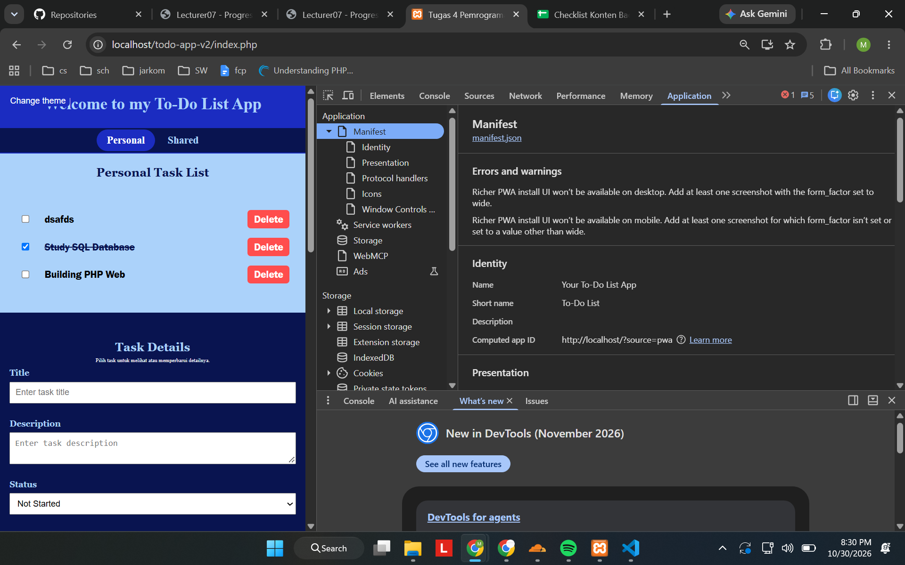
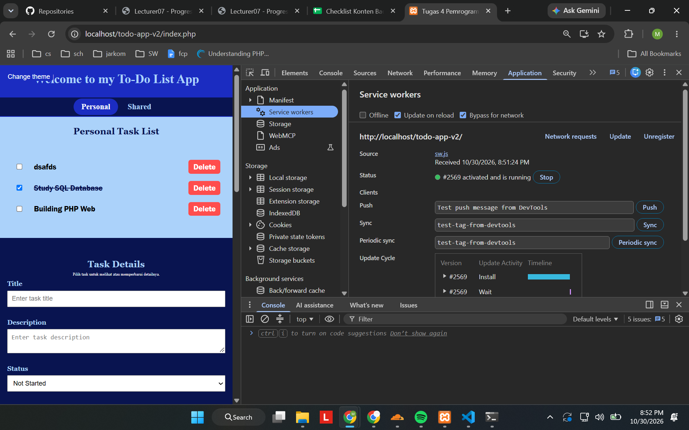
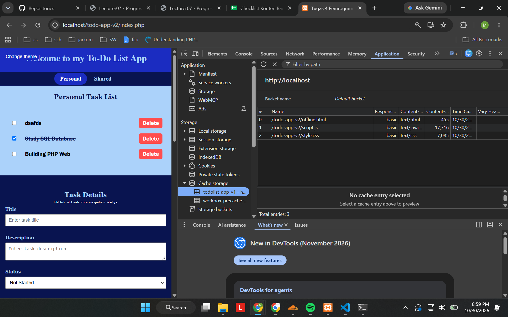
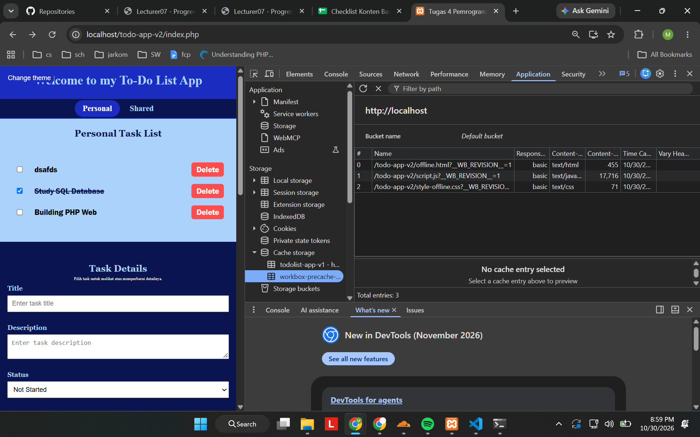
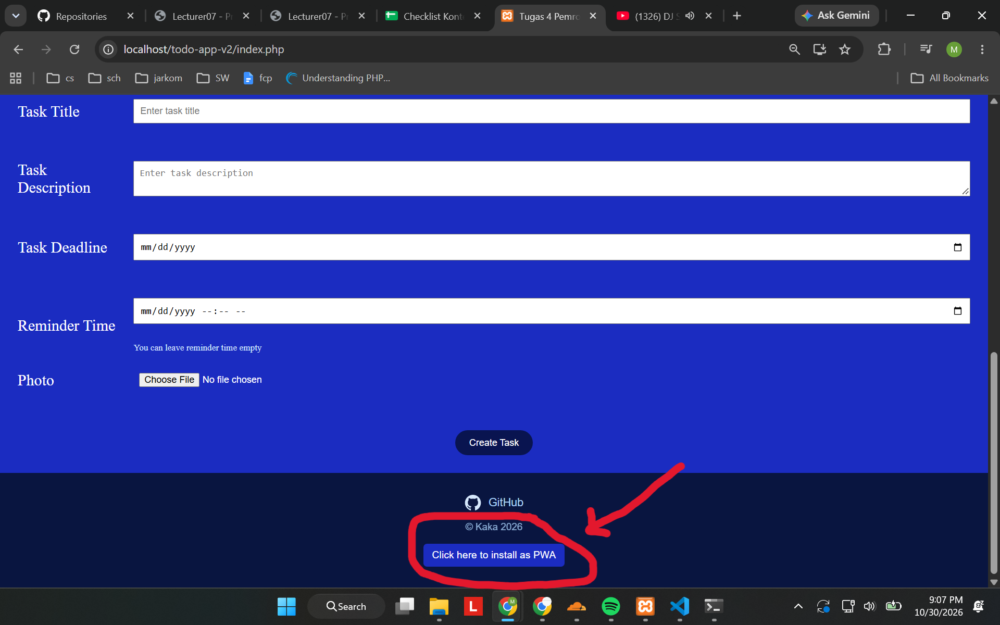

# Tugas5-PWeb
Tugas 5 Week 9 Matkul Pemrograman Web

## Name: Muhammad Ludaka Firdaus

## NRP: 5025251102

## Web Description:
This web contains a cache storage that will provide a page if a user doesn't have active internet connection. The web browser will automatically redirect the user to the offline.html (which is the page dedicated to offline user). However, user still can't connect to our database, they will be reserved only for a static pages. Beside that, the user also can install a Progressive Web Apps, they can install on their desktop from the web by clicking the install button available on the webpage.

## Preview:

**manifest.json file**

**service workers**

**caching strategis, cache storage**

**install button**
